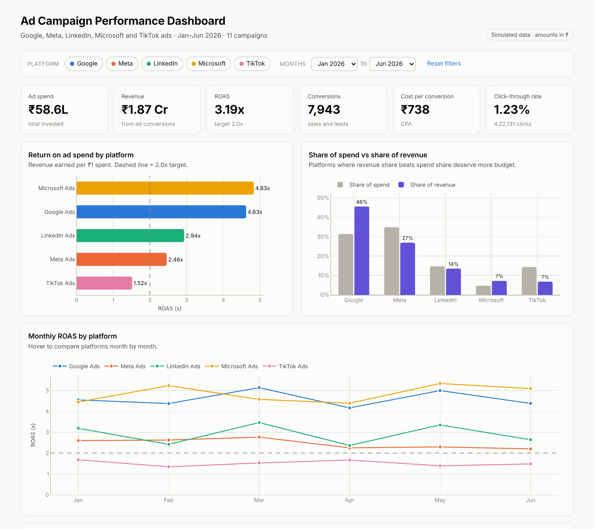
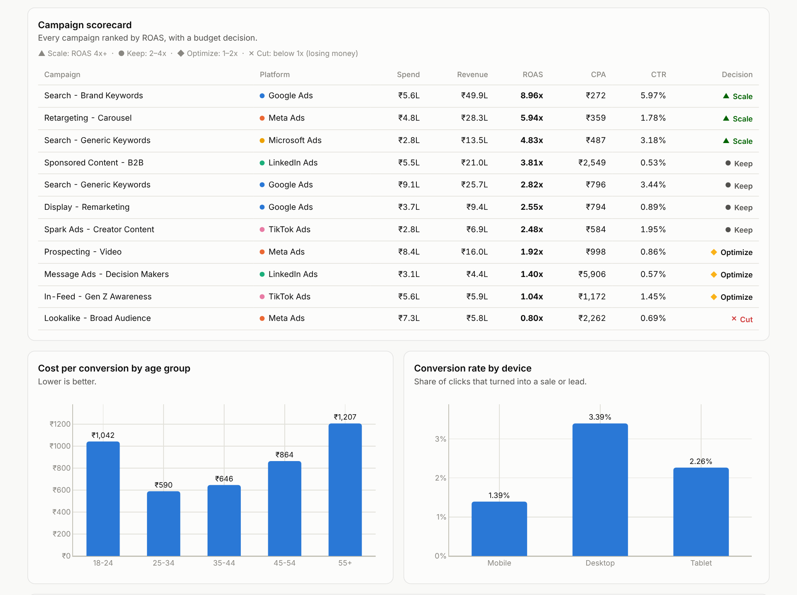

# Multi-Platform Ad Campaign Performance Dashboard

An end-to-end marketing analytics project that compares **11 ad campaigns across Google, Meta, LinkedIn, Microsoft and TikTok Ads**, finds where ad money is being wasted, and recommends how to move budget to get more revenue for the same spend.

**Tools:** Python (Pandas) · SQL (SQLite) · Plotly · Excel · Power BI (guide included)

### [▶ Open the live interactive dashboard](https://ayush-rag.github.io/Ad-campaign-performance-dashboard/)



---

## Business problem

A company runs ads on 5 platforms and spent **₹58.6 lakh in 6 months**. The marketing manager wants to know:

1. Which platforms and campaigns actually make money (ROAS)?
2. Which campaigns are losing money and should be cut?
3. Which audiences and devices convert cheapest?
4. Is any ad getting "tired" (falling click-through rate)?
5. How should the budget be moved to earn more revenue for the same spend?

## Key results

| Metric | Value |
|---|---|
| Total ad spend | ₹58.61 lakh |
| Revenue from ads | ₹186.76 lakh |
| Blended ROAS | **3.19x** |
| Conversions | 7,943 |
| Cost per conversion (CPA) | ₹738 |

### Insights

1. **Microsoft Ads has the best ROAS (4.83x) but gets only 4.8% of the budget.** TikTok Ads is the weakest at 1.52x, below the 2.0x target.
2. **Meta "Lookalike - Broad Audience" loses money:** ₹7.28 lakh spent, ₹5.84 lakh earned (ROAS 0.80x), a net loss of ₹1.44 lakh.
3. **Meta gets the biggest share of spend (34.8%) but only 26.9% of revenue.** Google gets 31.3% of spend and brings in 45.5% of revenue.
4. **Three campaigns earn 4x or more but get only 22% of the budget:** Google Brand Search (8.96x), Meta Retargeting (5.94x) and Microsoft Search (4.83x).
5. **Creative fatigue:** CTR on the Meta "Prospecting - Video" ad fell **35%** from January to June because the same video ran for 6 months.
6. **Best audience:** Ages 25-34 have the lowest cost per conversion (₹590). Ages 55+ cost twice as much (₹1,207).
7. **Device gap:** Desktop converts at **3.39%** vs **1.39%** on mobile, yet mobile receives 63% of spend.

### Recommendations

| Action | Campaign | Why |
|---|---|---|
| **Cut** | Meta - Lookalike Broad Audience | ROAS 0.80x: loses money |
| **Scale** | Meta - Retargeting Carousel, Microsoft - Generic Search | ROAS 4.8x-5.9x, room to grow |
| **Refresh creative** | Meta - Prospecting Video | CTR down 35% since January |
| **Optimize** | TikTok In-Feed, LinkedIn Message Ads | ROAS 1.0x-1.4x: tighten targeting or cut |
| **Shift targeting** | All platforms | Focus on ages 25-44 and raise desktop bids |

**Estimated impact:** Moving the ₹7.28 lakh from the "Cut" campaign to the two non-brand "Scale" campaigns could add about **₹24.37 lakh in revenue over 6 months, with no increase in total spend.**
*(Assumes moved budget earns 75% of the receiving campaign's current ROAS, since returns usually drop as budget grows. Brand search is excluded because its traffic is limited by how many people search the brand name.)*



---

## How it works

```
Raw ad export (30,045 rows, messy)
        │  src/generate_data.py
        ▼
Data cleaning (Pandas)                → data/processed/ad_campaigns_clean.csv
        │  src/clean_data.py
        ▼
SQL database (campaigns + ad_performance tables)
        │  src/load_database.py
        ▼
8 SQL KPI queries + budget reallocation model
        │  src/run_analysis.py       → outputs/ (CSV results, Excel report, insights)
        ▼
Interactive dashboard (Plotly)        → docs/index.html
           src/build_dashboard.py
```

### 1. Data
Real ad-account data is private, so the dataset is **simulated** with `src/generate_data.py`: 6 months (Jan-Jun 2026) of daily data for 11 campaigns, split by **age group** and **device**. Each platform follows typical industry ranges. For example, search ads have high CTR, LinkedIn has expensive clicks but high-value B2B customers, and TikTok has cheap clicks but low conversion. The script uses a fixed random seed, so it produces the same data every time.

**Columns:** date, platform, campaign, objective, age group, device, impressions, clicks, spend, conversions, revenue

### 2. Data cleaning
The raw export includes the kinds of problems real exports have:

| Problem | Rows | Fix |
|---|---:|---|
| Platform spelled differently ("Facebook Ads", "google", "Bing Ads", ...) | 2,402 | Mapped to 5 standard names |
| Spend saved as text ("₹1,234.50") | 1,502 | Removed ₹ and commas, converted to numbers |
| Blank revenue on rows with 0 conversions | 9,780 | Filled with ₹0 |
| Duplicate rows from overlapping exports | 180 | Removed |
| Clicks greater than impressions (tracking error) | 25 | Removed |
| Negative spend (refund adjustments) | 12 | Removed |

**Result:** 30,045 raw rows → 29,828 clean rows.

### 3. SQL analysis
The clean data is split into a `campaigns` table and an `ad_performance` fact table ([schema](sql/01_create_tables.sql)). All KPIs are calculated in SQL ([queries](sql/02_kpi_queries.sql)) using **JOINs, GROUP BY, HAVING, CTEs and window functions** (`RANK`, `FIRST_VALUE`, `SUM() OVER ()`).

| KPI | Formula |
|---|---|
| CTR (click-through rate) | clicks ÷ impressions |
| CPC (cost per click) | spend ÷ clicks |
| CVR (conversion rate) | conversions ÷ clicks |
| CPA (cost per acquisition) | spend ÷ conversions |
| ROAS (return on ad spend) | revenue ÷ spend |

Each campaign gets a budget decision based on ROAS: **Scale** (4x+), **Keep** (2-4x), **Optimize** (1-2x) and **Cut** (below 1x).

### 4. Dashboard
`docs/index.html` is a single-file interactive dashboard that works offline and is hosted free on GitHub Pages. Platform and month filters recalculate every chart, just like slicers in Power BI. It includes KPI cards, ROAS by platform, spend share vs revenue share, monthly ROAS trend, a campaign scorecard, and age and device breakdowns.

### 5. Excel report
`outputs/ad_kpi_report.xlsx` contains every analysis on its own sheet (Summary, Platforms, Campaigns, Budget Wasters, Reallocation Plan, Monthly Trend, Creative Fatigue, Age Groups, Devices, Insights).

### 6. Power BI version
[`powerbi/POWER_BI_GUIDE.md`](powerbi/POWER_BI_GUIDE.md) has step-by-step instructions and all DAX measures to rebuild this dashboard in Power BI Desktop.

---

## Project structure

```
ad-campaign-performance-dashboard/
├── main.py                       # runs the full pipeline
├── requirements.txt
├── src/
│   ├── config.py                 # paths and business assumptions (target ROAS etc.)
│   ├── generate_data.py          # 1. simulate raw ad export
│   ├── clean_data.py             # 2. clean it
│   ├── load_database.py          # 3. load into SQLite
│   ├── run_analysis.py           # 4. SQL KPIs, insights, Excel report
│   ├── build_dashboard.py        # 5. build HTML dashboard
│   └── dashboard_template.html
├── sql/
│   ├── 01_create_tables.sql
│   └── 02_kpi_queries.sql
├── data/
│   ├── raw/ad_campaigns_raw.csv
│   └── processed/ad_campaigns_clean.csv
├── outputs/
│   ├── ad_kpi_report.xlsx
│   ├── insights.md
│   ├── cleaning_log.csv
│   └── sql_results/              # one CSV per SQL query
├── docs/index.html               # interactive dashboard (GitHub Pages)
├── powerbi/POWER_BI_GUIDE.md
└── images/                       # screenshots
```

## How to run

```bash
git clone https://github.com/Ayush-rag/Ad-campaign-performance-dashboard.git
cd ad-campaign-performance-dashboard
pip install -r requirements.txt
python main.py
```

Then open `docs/index.html` in your browser. The whole pipeline runs in a few seconds.

**Using MySQL instead of SQLite:** The SQL works in MySQL 8 with two small changes: replace `strftime('%Y-%m', date)` with `DATE_FORMAT(date, '%Y-%m')`, and use `INT AUTO_INCREMENT PRIMARY KEY` for the `id` column.

**Using real data:** Replace `data/raw/ad_campaigns_raw.csv` with your own export (same columns) and run `python main.py` again, skipping step 1.

## Skills demonstrated

- **Data cleaning:** standardising categories, type conversion, deduplication, validation rules
- **SQL:** schema design, joins, aggregations, CTEs, window functions
- **Marketing analytics:** CTR, CPC, CVR, CPA, ROAS, audience and device analysis, creative fatigue
- **Business thinking:** turning KPIs into budget decisions and estimating revenue impact
- **Data visualisation:** interactive dashboard with filters, Excel reporting, Power BI

---

**Ayush Raghav** · B.Tech CSE, Manipal University Jaipur · ayushraghav.work@gmail.com
